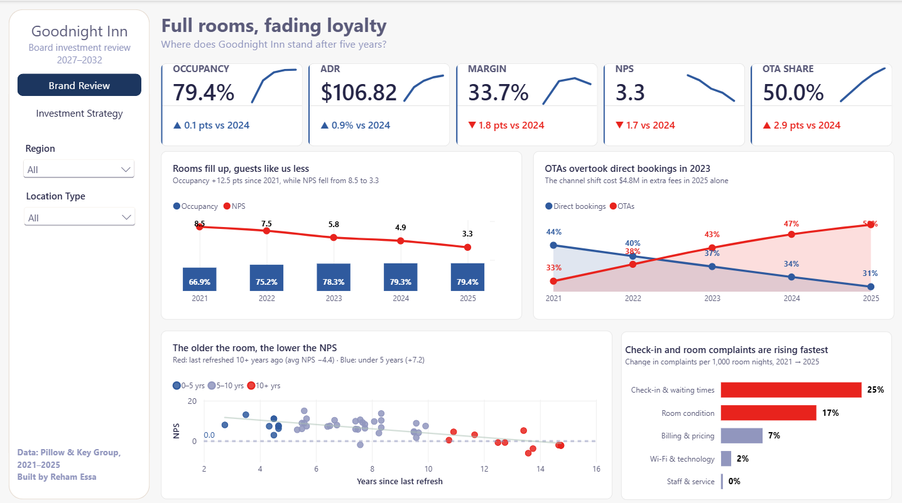
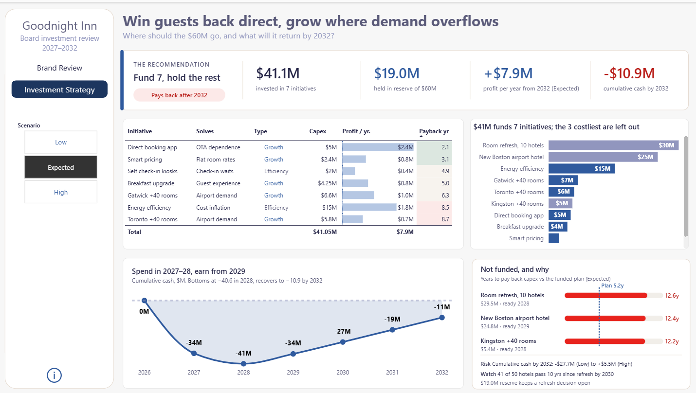

# Goodnight Inn – Full rooms, fading loyalty

**A $41M plan to win guests back.** Power BI entry for the **Power BI Dataviz World Championships 2027 – Round 1** (Pillow & Key Group investment challenge).

🔗 **[View the submission on the Fabric Community Contests Gallery](https://community.fabric.microsoft.com/discussions/pbi_contestsgallery/goodnight-inn--full-rooms-fading-loyalty-a-41m-plan-to-win-guests-back/5423007)**

---

## The challenge
Pillow & Key Group is a fictional hotel company with 165 hotels and four brands.
The Board is preparing a five-year investment plan, but the budget cannot fund every project.
This report reviews **Goodnight Inn** (budget & economy, 50 hotels, $60M budget) and answers two questions:

1. **Where does the brand stand today?** (2021–2025)
2. **Where should the money go, and what will it return by 2032?**

---

## Page 1 – Brand Review: *Full rooms, fading loyalty*

- **Rooms fill up, guests like us less.** Occupancy rose from 66.9% to 79.4% since 2021, while NPS fell from 8.5 to 3.3.
- **OTAs overtook direct bookings in 2023.** They now bring 50% of room revenue, and the channel shift cost **$4.8M in extra fees in 2025 alone**.
- **The older the room, the lower the NPS.** Hotels last refreshed 10+ years ago score NPS −4.4, vs +7.2 for those refreshed in the last 5 years. Hover any hotel to see its details.
- **Check-in and room complaints are rising fastest:** +25% and +17% per 1,000 room nights since 2021.

## Page 2 – Investment Strategy: *Win guests back direct, grow where demand overflows*

- **The recommendation: fund 7 initiatives for $41.1M and hold $19.0M in reserve.** Digital projects (booking app, smart pricing, self check-in kiosks) pay back fastest; airport extensions add capacity where demand overflows.
- **Not funded, and why:** the room refresh ($29.5M), a new Boston hotel ($24.8M) and the Kingston extension ($5.4M) each take over 12 years to pay back, vs 5.2 years for the funded plan.
- **Impact:** +$7.9M operating profit per year from 2032. Cumulative cash bottoms at −$40.6M in 2028 and reaches −$10.9M by 2032 (Expected), so the plan recovers its full cost during 2034.
- **Risk:** a Low / Expected / High switch moves every figure on the page, from −$27.7M to +$5.5M of cumulative cash by 2032.

---

## Interactive features
| Feature | What it does |
|---|---|
| **Scenario switch** | Low / Expected / High – the banner, cash flow and "Not funded" panel all recalculate |
| **Recommendation banner** | A data-driven SVG measure: the verdict pill turns blue when the plan pays back within 2032 |
| **"Not funded, and why" panel** | A data-driven SVG measure comparing each project's payback with the funded plan |
| **Hotel tooltip** | Hover any point on the scatter for the hotel's name, city, age and KPIs |
| **ⓘ How we calculated** | A bookmark overlay with every assumption behind the numbers |

## Method
- **Brand KPIs:** occupancy, ADR, margin after distribution cost (monthly results exclude channel fees), NPS weighted by survey responses, complaints per 1,000 room nights, years since last refresh (or opening).
- **Project cash flows** modelled monthly in a DAX calculated table, following the dataset's finance rules:
  - capex spread evenly over each project's duration from its earliest start
  - rooms out of service earn no revenue (counted as lost profit, the prudent reading)
  - ramp-up 50% / 85% / 100% in the first, second and third year after completion
  - 8% discount rate to January 2026
  - dependent projects start when their prerequisite finishes
- **Payback** = capex ÷ annual operating profit impact.

## Design and accessibility
- Two pages on a fixed 16 px grid, with a custom theme built from a single palette.
- One highlight colour: **red marks problems, blue marks the plan**.
- Text and chart colours checked against WCAG contrast; the blue/red pairing stays distinguishable with colour-vision deficiency.
- Alt text on every visual, a logical tab order, decorative shapes hidden from screen readers, minimum 10 pt text.

---

## How to open
1. Download the Excel dataset from the challenge page and place it in `data/`.
2. Open `report/GoodnightInn.pbip` in Power BI Desktop.
3. If refresh fails: *Transform data → Data source settings → Change Source* and point to `data/PillowKey_Dataset.xlsx`.

## Tools
Power BI Desktop · DAX · Power Query · SVG · Git

## Links
- 🏆 [My submission](https://community.fabric.microsoft.com/discussions/pbi_contestsgallery/goodnight-inn--full-rooms-fading-loyalty-a-41m-plan-to-win-guests-back/5423007)
- 📋 [Official contest page](https://community.fabric.microsoft.com/blog/community_blog/power-bi-dataviz-world-championships-the-road-to-atlanta-starts-here/5380736)
- 💼 [LinkedIn – Reham Essa](https://www.linkedin.com/in/reham-essa-/)

---
**Reham Essa** · Data Analyst · Microsoft Certified: PL-300, DP-700
